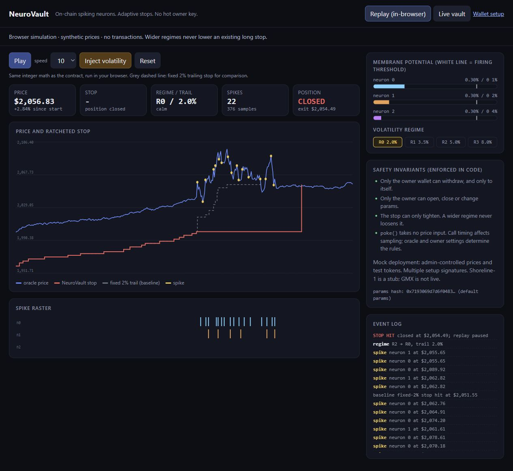
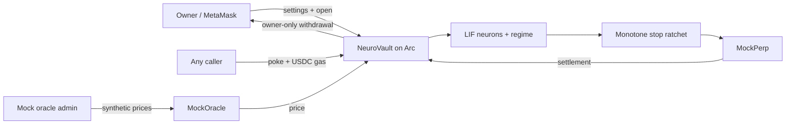

# NeuroVault

**Latest video:** [Final 2:30 MP4 with real deployment approvals, live result and replay](https://diadefi.github.io/neurovault/demo/neurovault-final-live-demo.mp4). Captioned, 1280×720, no audio; upload to YouTube/Drive for submission.

[Replay dashboard](https://diadefi.github.io/neurovault/index.html) · [Live Arc vault](https://diadefi.github.io/neurovault/index.html?mode=live) · [Current wallet control room](https://diadefi.github.io/neurovault/setup.html) · [Alternate demo runner](https://diadefi.github.io/neurovault/operate.html) · [5-minute pitch](https://diadefi.github.io/neurovault/docs/pitch.html) · [Backup video](https://diadefi.github.io/neurovault/demo/backup-replay.mp4)

[](https://github.com/diadefi/neurovault/actions/workflows/test.yml)

**Authorize your risk rules. On-chain spiking neurons manage the stop without a hot owner key.**

UBC 2026 · **DeFi and Onchain Applications** · **Best use of Arc** · No bounties
Team: **Darshan and Sebastian**

NeuroVault is a testnet prototype of permissionless, rule-bound risk automation. The owner configures a small leaky integrate-and-fire (LIF) neuron layer and opens a mock perpetual position. Anyone can call `poke()`: the vault reads its oracle, updates the neurons, and ratchets the stop. The caller gains no withdrawal authority.

**Scope:** `DeployMock` on **Arc Testnet**, chain **5042002**. Browser replay needs no wallet. GMX remains an experimental adapter tested with a local recording router, not a live deployment or production-ready integration. Shoreline-1 transport is a stub; the demo uses MetaMask.

[Open dashboard](https://diadefi.github.io/neurovault/) · [MetaMask setup](https://diadefi.github.io/neurovault/setup.html) · [Source code](https://github.com/diadefi/neurovault)



## Deployed contracts

Public mock contracts are deployed on **Arc Testnet**; see verified evidence in `deployments/arc-testnet.json`. Local addresses are not Arc addresses. Intended owner: `0xd952691a2b11dBaadc4AdDbaD59597772302fa02`.

| Contract | Network | Address |
|---|---|---|
| MockUSDC (mUSDC collateral) | Arc Testnet | [0x006445db90cbA7a84b03595cC59D27e2AEF025Db](https://explorer.testnet.arc.io/address/0x006445db90cbA7a84b03595cC59D27e2AEF025Db) |
| MockOracle (admin-set price) | Arc Testnet | [0x389135ad0Dcf828a5025335ed1861926fE8E035a](https://explorer.testnet.arc.io/address/0x389135ad0Dcf828a5025335ed1861926fE8E035a) |
| MockPerp | Arc Testnet | [0x3EbF0b03a581927B3eB87e3E138f7048FefbD57f](https://explorer.testnet.arc.io/address/0x3EbF0b03a581927B3eB87e3E138f7048FefbD57f) |
| MockPerpNeuroVault | Arc Testnet | [0xe581BF3B5aE2A3B34d7eC08C3af5F914581368a2](https://explorer.testnet.arc.io/address/0xe581BF3B5aE2A3B34d7eC08C3af5F914581368a2) |
| GmxNeuroVault | GMX adapter, local tests | Integration tested against the repo’s GMX ABI interface; **not deployed** |
| GMX ExchangeRouter / market integration | No live GMX network | Local recording-router tests against the repo’s GMX ABI interface; **not deployed** |

The four Arc addresses above were checked against the current compiled runtime (accounting for immutables). This is not explorer source verification. GMX tests cover order encoding and units using a local recording router; they do not establish compatibility with a currently deployed GMX router or its asynchronous lifecycle.

## Honest disclosures

- **Mock venue and demo oracle on Arc:** prices are admin-controlled, mUSDC is freely mintable, and this is not a real ETH perpetual market. Native test USDC pays gas; it is separate from mock collateral.
- **Demo params time-compressed ×12 in `operate.html` only:** τ 600 → 50 seconds and memory 1,800 → 150 seconds; intended poke spacing 60 → about 5 seconds, with a 4-second minimum and extra receipt latency. The already deployed vault and `setup.html` retain normal timing (600 / 1,800 / 60 seconds). Browser replay uses 60 simulated seconds per step; speed 10 means ten samples per wall-clock second, not ×12 parameter compression.
- **Shoreline-1 signer is a stub.** MetaMask signs the demonstrated owner actions. The alternate runner stores a gas-paying keeper/oracle-admin key in browser storage; it is not the owner key, but it can set mock prices.
- **Unaudited testnet code.** Tests and sampled fuzz paths are evidence, not a security audit or formal proof. Setup uses multiple owner transactions. Stop updates require callers and depend on oracle trust and sample timing.

## Problem and solution

Hardware wallets keep signing authority offline, but repeated discretionary adjustments need repeated approvals. Giving an online bot broad trading or withdrawal power expands the attack surface. Existing conditional orders already execute without fresh owner signatures. NeuroVault explores a particular improvement: adaptive volatility rules enforced inside the vault, with permissionless callers that cannot choose recipients or loosen an established stop.

1. Deploy and fund the mock vault. The owner signs settings and opens a position. **This prototype uses multiple setup transactions; literal one-signature setup is not implemented.**
2. Anyone calls `poke()`, paying their own network gas. No owner signature is needed for this action.
3. Absolute oracle returns enter three LIF neurons. Recent spikes select a target trailing distance of **2%, 3.5%, 5%, or 8%**.
4. A wider target never loosens the existing stop. Long stops only rise; short stops only fall. Widening can hold the stop in place instead of chasing the next price extreme.
5. A crossed stop settles on the mock venue. Proceeds return to the vault. Only the immutable owner can withdraw, only to itself.



## Arc integration

Neuron state, stop management and mock settlement execute on Arc Testnet. Network gas is paid in native **test USDC**. Trading collateral is a separate freely mintable **mUSDC**, not Circle USDC. We do not claim CCTP, Circle Wallets, real-USDC collateral, or cross-chain settlement.

| Setting | Value |
|---|---|
| Network / ID | Arc Testnet / `5042002` (`0x4cef52`) |
| RPC | `https://rpc.testnet.arc.io` |
| Explorer | `https://explorer.testnet.arc.io` |
| Native gas | USDC, 18-decimal native accounting |
| Faucet | <https://faucet.circle.com> (Arc Testnet / USDC) |

Sources: [network settings](https://docs.arc.io/arc/references/connect-to-arc), [gas and fees](https://docs.arc.io/arc/references/gas-and-fees), [EVM differences](https://docs.arc.io/arc/references/evm-differences). General EVM tests do not reproduce every Arc-specific runtime rule; public receipts are separate deployment evidence.

## Safety properties and limits

Owner-only configuration, opening, closing and withdrawals; fixed withdrawal destination; monotone stops while active; oracle rejection of nonpositive prices, zero/future/stale timestamps and incomplete rounds. Mock `syncPosition()` reconciles direct venue settlement using the recorded exit price, even after a price rebound or oracle outage.

| Risk | Actual behavior |
|---|---|
| Oracle trust | The deployer can set arbitrary demo prices. This is a trusted mock, not a production oracle. |
| Caller timing | `poke()` accepts no price or recipient, but valid call timing affects sampling and neuron evolution. |
| Liveness | Without callers, no adaptation occurs. Stop execution also needs `poke()` or the venue's `executeStop()`. |
| Gaps | Stops are triggers, not guaranteed fills. Mock settlement uses the execution-time price. |
| Mock economics | Mintable collateral and seeded liquidity; no real order book, funding, liquidation engine or insolvency protection. |
| Owner risk | A compromised owner can change rules, close and withdraw. The contract limits callers, not the owner. |
| Contract risk | Hackathon code, unaudited, testnet only. Fuzz samples are not a formal proof. |
| GMX | Three local recording-router tests cover constructed orders and unit conversion. No live fills, fork test, deployed-ABI proof, or asynchronous lifecycle verification. |

## Neuron math

```text
x = abs(price - lastPrice) * 1e18 / lastPrice
v[i] = v[i] * tau[i] / (tau[i] + elapsedSeconds)
v[i] += weight[i] * x / 1e18
if v[i] >= theta[i]: emit spike; v[i] = 0
regime = highest recently spiking neuron + 1; otherwise zero
candidateLongStop = highestObservedPrice * (10000 - trailBps[regime]) / 10000
newLongStop = max(oldLongStop, candidateLongStop), subject to minimum improvement
```

Default thresholds: 1%, 2%, 4% integrated absolute return; 600-second leak constants; 1,800-second spike memory; 60-second minimum poke interval; 10-basis-point minimum stop improvement. Rational leak approximates decay and accounts for elapsed time, but does not make sampling schedules equivalent. Trends can cause spikes too: this is a thresholded return accumulator, not a trained model or price predictor.

Python and browser replay share the core integer math. The integration check compares potentials, regime, stop and active state on identical prices/timestamps across Solidity, Python and the browser model. Simulations do not reproduce chain access control, transaction fees or oracle failures; their default random paths use different generators.

## Economic design

Callers pay gas and receive no protocol reward in this prototype. A user-funded keeper supplies liveness. Cooldown and minimum improvement reduce redundant updates. No protocol fee is charged.

Adaptive stops can survive some paths that cross a fixed 2% trail, but can also realize larger losses or give back more gains. Report the actual replay rather than general outperformance. **Safer delegation of authority, not price prediction.**

## Results

Reproduce with `python sim/evaluate.py`. This runs the existing `sim/snn_sim.py` model over **seeds 0–49**, each with 720 one-minute synthetic samples and a long position. The generated volatility burst occupies indices 240–329; “survived” means still open immediately after the last burst sample. Both strategies share prices, initial entry, the 10-basis-point minimum stop improvement, and settlement at the observed crossing price. The baseline is a **fixed-width 2% trailing stop**, not a static stop price. The evaluation uses uncompressed default parameters.

| Strategy | Survived burst | Stopped by sample 720 | Mean exit price when stopped | Mean stop updates / path |
|---|---:|---:|---:|---:|
| SNN adaptive trail | 27 / 50 (54%) | 26 / 50 | $2,011.73 (26 exits) | 28.4 |
| Fixed 2% trail | 10 / 50 (20%) | 40 / 50 | $2,034.26 (40 exits) | 28.6 |

On these synthetic paths, it **survives shakeouts more often, exits lower when a widened stop hits**; this is a tradeoff, not price prediction or evidence of profitable trading. The exit averages use different stopped subsets and exclude positions still open. On the 26 matched seeds where both stopped, the SNN exit was lower in 16 cases, by $13.85 on average across all 26 pairs; it was not lower on every path. Stop updates exclude the initial order and total 1,420 vs 1,430. No fees, funding, slippage, liquidation or historical market data are modeled. These are descriptive results from one synthetic generator, not a market backtest.

Raw evidence: [per-seed CSV](sim/out/evaluation.csv), [parameters and JSON](sim/out/evaluation.json). The JavaScript video uses its own seeded generator and a scripted burst at step 200; it is a separate demonstration, not one of these 50 Python paths.

## Run locally

Requirements: Foundry, Solidity 0.8.24, Node 20+, Python 3.10+ and matplotlib for charts.

```bash
forge install foundry-rs/forge-std@v1.9.6 OpenZeppelin/openzeppelin-contracts@v5.1.0 --no-git
forge test
npm ci --prefix offchain
npm test --prefix offchain
python -m pip install -r sim/requirements.txt
python sim/snn_sim.py
python tools/export-artifacts.py
python -m http.server 8089 --bind 127.0.0.1 --directory frontend
```

Open <http://127.0.0.1:8089>. Replay is browser-only; ethers is vendored. For a complete local lifecycle, start `anvil --port 8548`, then run `node offchain/local-demo.mjs`. It refuses non-loopback RPCs and chains other than 31337. It deploys, configures, opens, pokes, compares model state, settles, withdraws, and leaves a fresh position for live QA. Addresses go to ignored `deployments/local.json`; evidence is labeled local.

Windows: `tools/dev.ps1` supports `test`, `build`, `sim` and `serve`, using available local tool copies.

## Deploy on Arc with MetaMask

1. Request **test USDC on Arc Testnet** for the intended owner/deployer from Circle's faucet.
2. Open `setup.html` in the browser where MetaMask is installed. The page requests chain 5042002 and checks it before actions.
3. Click **Deploy / resume**. Approve four deployments and two mock-token mints, matching the `DeployMock` suite. The deployer controls the mock oracle; the specified owner owns the vault.
4. Download the address manifest. From the owner account, click **Sign neuron settings**, then **Open demo long**.
5. Set a synthetic price and click **Poke vault**. Respect the 60-second cooldown. A second funded account can poke but cannot withdraw.
6. Open the live dashboard and save explorer receipts for submission.

Progress is saved by chain and owner; retain the downloaded manifest. CLI equivalent, using a locally imported encrypted Foundry keystore:

```bash
export OWNER=0xd952691a2b11dBaadc4AdDbaD59597772302fa02
forge script script/Deploy.s.sol:DeployMock --rpc-url https://rpc.testnet.arc.io --chain 5042002 --account arc-demo --broadcast
```

Arc's current docs also provide `arc-forge` for Arc-specific runtime testing. Check current network fee estimates before broadcast. Do not run `DeployGmx` on Arc; its addresses target another network.

## Keeper and signing

```bash
RPC=https://rpc.testnet.arc.io VAULT=<vault> KEEPER_KEY=<gas-only-test-key> node offchain/keeper.mjs
```

The keeper needs gas, not owner privileges. Replay mode additionally needs the oracle admin signer, which can change mock prices. `--fast` is restricted to local chain 31337.

`offchain/owner.mjs` supports software test signing, manual raw-hash signing and an unimplemented Shoreline-1 transport. Manual mode needs an **unprefixed EIP-1559 transaction hash signed with secp256k1**; ordinary `personal_sign` message signatures are incompatible. The recovered owner is checked before broadcast. MetaMask users use `setup.html`. Legacy CLI names `fund-eth`/`withdraw-eth` refer to native value, which is USDC on Arc. The mock vault needs no native funding.

## Repository

| Path | Purpose |
|---|---|
| `src/` | Core vault, mock venue and experimental GMX adapter |
| `test/` | 30 Foundry tests, including 256 long and 256 short fuzz paths |
| `offchain/` | Keeper, signing, regression test, local integration and deployment recording |
| `frontend/` | Replay, live dashboard and MetaMask control room |
| `sim/` | Python model, parameters, trace and chart |
| `tools/` | Artifact export and local commands |
| `submission/` | Devpost copy and demo/pitch scripts |
| `docs/pitch.html` | Six-slide finalist deck with speaker notes (press N) |
| `demo/backup-replay.mp4` | About 2:30 of browser replay, H.264; no transactions |
| `PROGRESS.md` | Completion evidence, exact links and morning checklist |
| `evidence/` | Environment-labeled verification evidence |

## Next

Independent audit, production oracle/keeper integration, GMX asynchronous lifecycle reconciliation, historical-data evaluation, real hardware signing, and market-wide margin/open-interest controls. Copper/palladium protection, event-aware neurons, CCTP and a Solana port are roadmap ideas, not delivered features.
