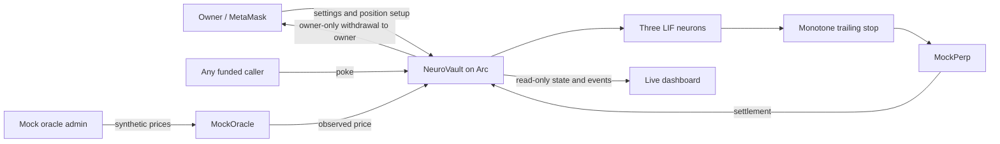

# NeuroVault — complete team handoff

**Prepared November 20, 2026, America/Chicago. Team: Darshan and Sebastian.**

**Start here:** the mock stack is already deployed on Arc Testnet, the website is public, the README has the addresses and disclosures, CI passes, and a 2:30 backup video exists. Do not spend the remaining submission window redeploying an already working stack. The main remaining submission task is to put the demo on **YouTube or Google Drive**, verify judge access, and submit the final Devpost entry.

This document combines the latest submission-guide text supplied by the team with the actual repository/deployment evidence. Event requirements below are from that supplied guide, not an independent organizer confirmation. Deployed-state snapshots have timestamps; they are not a claim that the position is still open now.

## 1. Branch, repository and quick links

- **Public repository:** https://github.com/diadefi/neurovault — visibility checked again for this handoff: public.
- **Requested handoff branch:** [`hackathon-11/20/2024`](https://github.com/diadefi/neurovault/tree/hackathon-11/20/2024).
- The requested label was “hackathon 11/20/2024.” Git does not allow spaces, so the space was replaced with a hyphen. **2024 was preserved deliberately as the requested branch label; this event and handoff are dated 2026.**
- This branch starts from completed-work commit `4706992`. The repository default branch remains `codex/arc-hackathon`; creating this branch does not change the default branch or redeploy the website.
- **Share this Markdown:** https://github.com/diadefi/neurovault/blob/hackathon-11/20/2024/TEAM-HANDOFF.md

| What you need | Exact link |
|---|---|
| Replay, no wallet required | https://diadefi.github.io/neurovault/index.html |
| Live deployed Arc vault | https://diadefi.github.io/neurovault/index.html?mode=live |
| Current vault / MetaMask control room | https://diadefi.github.io/neurovault/setup.html |
| Alternate compressed runner | https://diadefi.github.io/neurovault/operate.html |
| Backup demo MP4 | https://diadefi.github.io/neurovault/demo/backup-replay.mp4 |
| Six-slide pitch deck | https://diadefi.github.io/neurovault/docs/pitch.html |
| Devpost answer draft | [submission/DEVPOST.md](submission/DEVPOST.md) |
| Video and in-person script | [submission/DEMO-SCRIPT.md](submission/DEMO-SCRIPT.md) |
| Overnight completion record | [PROGRESS.md](PROGRESS.md) |
| CI workflow | https://github.com/diadefi/neurovault/actions/workflows/test.yml |
| Recorded deployment / all receipts | [deployments/arc-testnet.json](deployments/arc-testnet.json) |

## 2. Submission requirements and timing

Per the latest guide text supplied by the team:

- **Submission deadline: Friday, November 20, 2026, 12:00 PM CST.** Target **11:30 AM CST** to leave a buffer. The copied message's “8:58 now” was a timestamp in that message, not a live countdown; check the actual clock.
- A **2–3 minute demo video showing the product in action is required**, with a link to **Google Drive or YouTube**. The supplied guide says missing it also disqualifies a team from the participation prize.
- YouTube should be **unlisted**, not private; Google Drive should allow **anyone with the link to view**. Test the exact final link in an incognito/signed-out window before submission.
- Include deployed/used **contract addresses**, a **public** GitHub repo, an **architecture overview**, and **setup instructions**.
- For the DeFi track, the README must describe **economic design and risk assumptions**. Explain **how Arc is used** for the Arc award. Those README sections are already present.
- Devpost selections: **DeFi and Onchain Applications**; chain award **Best use of Arc**; **no bounties**. Do not claim Gemini, ElevenLabs, QuickNode or Grok integrations.
- Finalist notifications: by **11:59 PM CST Friday**, per the supplied text.
- In-person finals on **Saturday, November 21**: **four minutes presenting plus two minutes Q&A**. Teams must attend the in-person closing ceremony to qualify for prizes, per the supplied text.

**Important correction:** the existing HTML deck was originally requested with five-minute notes. Use the four-minute outline in section 12 for the latest stated finalist format. The current committed video script targets **2:30**; the copied message mentions a separate **2:40** `devpost-submission` document that was not supplied as a repository file. Both durations fit the stated video limit; do not concatenate them or pad past three minutes.

### Remaining checklist

- [ ] Choose the final 2–3 minute recording. A captioned backup is ready; a narrated live/replay demonstration is preferable if time permits.
- [ ] Upload the chosen video to YouTube or Drive with the permissions above. The GitHub Pages MP4 is a backup asset, **not a substitute for the requested YouTube/Drive submission link**.
- [ ] Open the uploaded video in incognito and verify it plays without requesting access.
- [ ] Review the Devpost draft for team details and actual scope. Add the final video link.
- [ ] Include the public repository, dashboard and all four Arc addresses below. Those addresses are already filled in; no deployment-address placeholders remain in the README.
- [ ] Select the track and Arc award, no bounties, then submit before the deadline. Save confirmation of submission.
- [ ] Rehearse the four-minute finalist version and coordinate Saturday attendance.

Suggested remaining allocation, since deployment and README are done: 15 minutes reviewing evidence/Devpost copy; 35–45 minutes recording or adding narration; 15–20 minutes uploading and testing permissions; submit as soon as complete, aiming for 11:30. Do not wait for that target if ready earlier.

## 3. Product and pitch

**One line:** NeuroVault puts adaptive stop rules on-chain so an online keeper does not need the owner's key.

**Problem:** hardware wallets preserve signing authority offline, while discretionary trading adjustments require the owner to return and sign. Giving an online bot broad trading/withdrawal authority introduces additional risk. Existing conditional orders already automate stop execution; our contribution is a compact adaptive policy enforced inside a vault.

**Mechanism:**

1. The owner approves settings and opens a mock position. The implemented prototype uses multiple setup transactions.
2. Anyone calls `poke()`. The contract reads its configured oracle; the caller supplies neither a price nor a withdrawal destination.
3. Absolute price returns enter three leaky integrate-and-fire neurons. Recent spikes select a target trail of 2%, 3.5%, 5% or 8%.
4. The stop ratchets: long stops can rise or remain unchanged; short stops can fall or remain unchanged. A wider target does not loosen a stop already set.
5. The mock venue settles crossed stops back into the vault. Only the owner may withdraw, and the recipient is always that owner.

**Honest pitch:** “Authorize your risk rules. On-chain spiking neurons manage the stop without a hot owner key.”

**Honest tradeoff:** adaptive trails can survive volatility shakeouts more often on the tested synthetic paths, but can exit lower when a widened trail eventually hits. This is safer delegation, not price prediction.

Avoid the original literal “sign once” claim. Avoid saying neurons replace the need for a keeper, or that caller timing has no effect. The neuron model is deterministic and untrained; it is not an LLM or a trained trading predictor.

## 4. What is already deployed

**Network:** Arc Testnet. **Chain ID:** `5042002` / `0x4cef52`.

**RPC:** `https://rpc.testnet.arc.io`.

**Explorer:** `https://explorer.testnet.arc.io`.

**Faucet:** https://faucet.circle.com/ — select Arc Testnet and test USDC.

**Gas:** native test USDC, 18-decimal native accounting. **Collateral:** separate freely mintable mUSDC, six decimals. These are different assets; the demo does not trade real Circle USDC collateral.

**Immutable vault owner and mock-oracle admin:** `0xd952691a2b11dBaadc4AdDbaD59597772302fa02`. The owner uses MetaMask. Teammates do not need or receive the owner's private key.

| Contract | Address / explorer |
|---|---|
| MockUSDC | [0x006445db90cbA7a84b03595cC59D27e2AEF025Db](https://explorer.testnet.arc.io/address/0x006445db90cbA7a84b03595cC59D27e2AEF025Db) |
| MockOracle | [0x389135ad0Dcf828a5025335ed1861926fE8E035a](https://explorer.testnet.arc.io/address/0x389135ad0Dcf828a5025335ed1861926fE8E035a) |
| MockPerp | [0x3EbF0b03a581927B3eB87e3E138f7048FefbD57f](https://explorer.testnet.arc.io/address/0x3EbF0b03a581927B3eB87e3E138f7048FefbD57f) |
| MockPerpNeuroVault | [0xe581BF3B5aE2A3B34d7eC08C3af5F914581368a2](https://explorer.testnet.arc.io/address/0xe581BF3B5aE2A3B34d7eC08C3af5F914581368a2) |

The four deployments and two mints succeeded. Deployed runtime bytecode and owner/contract relationships were checked against the local build, accounting for compiler immutable references. This is **not** an explorer “verified source” claim.

| Action | Transaction |
|---|---|
| Deploy MockUSDC | [0x121366990288dee2249e608b6c9f3b39dcfb15f4e157d8d476e96474400d3fb3](https://explorer.testnet.arc.io/tx/0x121366990288dee2249e608b6c9f3b39dcfb15f4e157d8d476e96474400d3fb3) |
| Deploy MockOracle | [0x1fb6844314a4008a790bbec2da2d6c5662ff7102bff122e3479945bab62d2613](https://explorer.testnet.arc.io/tx/0x1fb6844314a4008a790bbec2da2d6c5662ff7102bff122e3479945bab62d2613) |
| Deploy MockPerp | [0x43322b0ed0f3e87bbfb17bab311e21155d37f04e4a452ddbeff64551fbaa811d](https://explorer.testnet.arc.io/tx/0x43322b0ed0f3e87bbfb17bab311e21155d37f04e4a452ddbeff64551fbaa811d) |
| Deploy vault | [0xcc470096fb8b84a831111c2bcc44aa4779a03b51c014b7e57ef392d08960d523](https://explorer.testnet.arc.io/tx/0xcc470096fb8b84a831111c2bcc44aa4779a03b51c014b7e57ef392d08960d523) |
| Mint venue liquidity | [0x6ba5ed6dcf7ea58a5bfd810cec3329b727e14176132b7e03e21f6cebd78c1636](https://explorer.testnet.arc.io/tx/0x6ba5ed6dcf7ea58a5bfd810cec3329b727e14176132b7e03e21f6cebd78c1636) |
| Mint vault collateral | [0x9fd77e5e48d355262265314ccb2e9562fb253512357435ffa9fd2315af1c43f7](https://explorer.testnet.arc.io/tx/0x9fd77e5e48d355262265314ccb2e9562fb253512357435ffa9fd2315af1c43f7) |

Vault deployment block: **73163694**. Owner-authorized params hash: `0x7193069d7d6f0483f928d38110b776cfd484cd0182ab3a05e9e061776e230793`.

The latest saved read-only snapshot is **03:21:31 CST November 20**: active $5,000 mock long, entry $2,000, stop $1,960. Check live state before using those numbers in a recording. `deployments/arc-testnet.json` has an earlier `positionActive: false` snapshot from before opening; it is historical deployment evidence, not a live status feed.

## 5. Architecture and repository map



| Path | What is there |
|---|---|
| `src/NeuroVault.sol` | Ownership, settings, oracle validation, LIF layer, ratchet |
| `src/MockPerpNeuroVault.sol` | Mock venue adapter and settlement reconciliation |
| `src/mocks/Mocks.sol` | Mock collateral, admin oracle and perp venue |
| `src/GmxNeuroVault.sol`, `src/interfaces/` | Experimental GMX adapter/interfaces; not deployed |
| `test/` | 30 Foundry tests; two 256-run fuzz tests |
| `script/Deploy.s.sol` | `DeployMock`; separate unfinished live-GMX deployment path |
| `offchain/keeper.mjs` | Permissionless keeper; replay additionally requires oracle-admin authority |
| `offchain/owner.mjs` | Software/manual transaction signing; Shoreline stub; `--dry` builds without sending |
| `offchain/local-demo.mjs` | Local Anvil lifecycle and Solidity/Python/browser parity checks |
| `offchain/record-deployment.mjs` | Read-only chain verification and public manifest recording; pinned to the current intended owner |
| `frontend/index.html` | Browser replay and live on-chain dashboard |
| `frontend/setup.html`, `setup.js` | Current MetaMask control room, saved deployment/resume/import |
| `frontend/operate.html` | Alternate older runner with browser-held keeper key and compressed demo timing |
| `frontend/artifacts.js`, `contracts.js`, `abi.js` | Current build artifacts and dashboard ABI |
| `frontend/deployment.js`, `deployment.json` | Published default vault addresses and starting block |
| `frontend/vendor/` | Vendored ethers and license |
| `sim/snn_sim.py`, `sim/evaluate.py` | Integer model and reproducible 50-seed evaluation |
| `sim/out/` | Parameters, traces/chart, per-seed CSV/JSON |
| `demo/backup-replay.mp4` | Ready 2:30 browser-replay fallback |
| `docs/pitch.html` | Six-slide deck; arrows to navigate, N for notes |
| `submission/` | Devpost draft and recording/pitch scripts |
| `evidence/` | Timestamped on-chain reads, screenshots, browser checks and recording evidence |
| `.github/workflows/test.yml` | Foundry + Node CI on push/PR/manual run |
| `.github/workflows/pages.yml` | Manual GitHub Pages publishing, including deck and video |

## 6. Completed work and validation

The starting zip was repaired and made portable, rather than rebuilt from scratch. Before the public deployment, work included oracle validation, long/short ratchet tests, reconciliation after external mock settlement, immediate settlement when a newly tightened stop is already crossed, manual-signature recovery handling, local-only fast keeper replay, and clearer wallet errors. The current deployment was checked against that repaired source.

The public control room supported the successful four-contract deployment and two token mints. The owner subsequently signed settings and opened the position. The earlier `eth_sendTransaction` error 4100 was a wallet-account permission issue; later successful receipts supersede that old log entry.

The overnight packaging work added the README disclosures/results, published the existing alternate runner with current artifacts, recorded the fallback video, authored the six-slide deck, and produced reproducible evidence. **It sent no transactions and changed no files in `src/`. This branch/handoff work also sends no transactions.**

| Check | Recorded result |
|---|---|
| Solidity suite | **30 passed**, 0 failed: 27 core/mock tests + 3 GMX recording-router tests |
| Fuzz cases | 256 randomized long paths + 256 short paths; sampled evidence, not proof |
| Node suite | **4 passed**, covering manual signature formats and wallet-error handling |
| Local model parity | Solidity, Python and browser state checked on the same 13 price/time samples |
| Local lifecycle | Deploy/configure/open/poke/settle/withdraw exercised on Anvil before the no-transaction packaging phase |
| Public runtime | Four deployed runtimes and ownership/contract relationships checked; six successful setup receipts |
| Headless HTTPS | Dashboard, `operate.html`, `setup.html`, deck and required JS assets: HTTP 200, zero console errors/failed requests at 03:24 CST |
| Backup video | 150 seconds, H.264, `veryfast`, 1600×1000, 3,052,717 bytes; full decode passed; sampled frames inspected |
| Completed-base CI | [Run 44710565646 passed](https://github.com/diadefi/neurovault/actions/runs/44710565646) |
| Pages publication | [Run 44710277179 passed](https://github.com/diadefi/neurovault/actions/runs/44710277179) |

Solidity source tree preserved since deployed-build documentation commit `bef2a3b`: `45dff5d41ca8751d9c4031d3744e1eefb0a03e91`. Do not silently edit Solidity and continue presenting these addresses as the new implementation.

## 7. Economic design, results and risk assumptions

Anyone can pay gas to advance the rules. The prototype charges no protocol fee and offers no keeper reward; user-funded keepers supply liveness. Minimum improvement and a cooldown limit redundant updates. This does not remove oracle, execution, liquidity or owner-key risk.

| Strategy | Survived synthetic burst | Stopped by end | Mean exit among stopped positions | Mean stop updates |
|---|---:|---:|---:|---:|
| SNN adaptive trail | 27 / 50 (54%) | 26 / 50 | $2,011.73 | 28.4 |
| Fixed 2% trailing baseline | 10 / 50 (20%) | 40 / 50 | $2,034.26 | 28.6 |

Method: Python seeds 0–49; 720 one-minute samples per path; long positions; burst indices 240–329; default uncompressed params; same 10-basis-point minimum improvement. Stop updates exclude the initial order. Exit means use different stopped subsets; open positions are excluded. On 26 paired seeds where both stopped, the SNN exited lower in 16 cases, with a mean SNN-minus-fixed exit difference of −$13.85 across all 26 pairs. No fees, funding, slippage or liquidation are modeled. These synthetic results are not a historical backtest or a claim of profitable trading.

Disclose the following:

- **Mock market:** deployer-controlled price feed, freely mintable collateral, seeded liquidity; no real order book/funding/liquidation engine or insolvency protection.
- **Oracle and timing:** the admin can change prices; caller timing affects the samples and neuron state. `poke()` taking no arguments does not mean callers have no influence on timing.
- **Liveness:** no callers means no adaptation. Stop execution also requires a transaction.
- **Fill price:** a stop is a trigger, not a guaranteed execution price. Gaps can produce worse fills.
- **Owner:** only the owner changes settings or withdraws; a compromised owner remains dangerous.
- **Code:** unaudited testnet prototype. Tests are not a formal proof.
- **Arc use:** EVM execution of policy, neurons and mock settlement, with native test-USDC gas. No CCTP, Circle Wallets or real-USDC collateral integration is claimed.
- **GMX:** three local recording-router tests cover constructed orders and unit conversion against the repo's ABI interface. No live GMX deployment, deployed-ABI compatibility proof, fork validation or full asynchronous lifecycle handling is demonstrated.
- **Shoreline-1:** transport is a stub. Ethereum/secp256k1 signing on the hardware is not confirmed. MetaMask is the demonstrated owner signer. Manual mode requires a raw EIP-1559 transaction-hash signature; ordinary `personal_sign` is incompatible.

## 8. Operate the existing vault — recommended demo path

1. Open the live dashboard. Reading it needs no wallet. Check the chain, vault address and current position status.
2. On the owner's MetaMask browser, open `setup.html` and connect the intended owner on Arc Testnet. Use native **test** USDC for gas.
3. If the page has no saved addresses, use **Restore a downloaded deployment** and import the owner's exported JSON or the committed `deployments/arc-testnet.json`. Its owner, chain ID, addresses and `fromBlock` satisfy the import schema. Import only restores local UI state; actions verify contract relationships.
4. **Do not click Deploy / resume just to restore access.** The current deployment already exists. The committed manifest is evidence and may omit UI completion flags; unnecessarily running deployment/mint logic can cause extra transactions.
5. Owner settings/opening already happened. Inspect state before signing again; an active position must not be opened a second time.
6. For an intentional live demo transaction, the oracle admin sets the mock price, then a funded caller calls **Poke vault**. Respect the **60-second** minimum interval. Both are separate transactions shown in MetaMask. Only the oracle admin can set prices; any funded caller can poke.
7. Example only if state still matches the initial calm long: moving price from $2,000 to $2,010 and poking would normally tighten the stop toward $1,969.80. Check actual regime/state; do not promise that number after an intervening sequence.
8. **Sync venue settlement** reconciles a position already closed directly on the mock venue; it does not manufacture a close. Owner close and withdrawal are separate intentional actions. Withdrawal goes only to the immutable owner.
9. Save the relevant explorer receipts for the video/Devpost evidence. Never share seed phrases, private keys, browser keeper storage or wallet passwords in this repository or team chat.

### Normal timing versus the alternate runner

The existing vault / `setup.html` uses τ **600 s**, spike memory **1,800 s**, minimum poke interval **60 s**. Browser replay advances 60 simulated seconds each step; selecting speed 10 gives ten steps per wall-clock second.

`operate.html` is an alternate runner for a **separate deployment**, with a browser-stored keeper/deployer key. It uses τ **50 s**, memory **150 s**, roughly **5 s** target spacing and a **4 s** minimum cooldown. Only leak and memory are exactly ×12 compressed; receipt latency affects actual pacing. That keeper can set its mock oracle's prices, even though it cannot withdraw as owner. Its storage and deployment are separate from `setup.html`; it is not a drop-in way to speed up the existing vault. Use it only for a deliberate new test deployment.

## 9. Clone, build and reproduce locally

Requirements: Git; Foundry (CI uses **1.4.2**); Solidity **0.8.24**; Node **20+** (CI uses 22); Python **3.10+**. Project dependencies are pinned through the install command and npm lockfile. A fresh clone does not include ignored dependencies, compiler downloads or `.tools/` helpers.

```bash
git clone --branch 'hackathon-11/20/2024' --single-branch https://github.com/diadefi/neurovault.git
cd neurovault
forge install foundry-rs/forge-std@v1.9.6 OpenZeppelin/openzeppelin-contracts@v5.1.0 --no-git
forge test
npm ci --prefix offchain
npm test --prefix offchain
python -m pip install -r sim/requirements.txt
python sim/snn_sim.py
python sim/evaluate.py
python -m http.server 8089 --bind 127.0.0.1 --directory frontend
```

Open http://127.0.0.1:8089/index.html for replay. Local serving is not a blockchain deployment. Wallet extension permissions and browser storage are origin-specific; a local page will not inherit the public site's saved deployment.

If `python` opens the Microsoft Store alias on Windows, use your installed Python executable, an activated Python environment, or `py` if installed. `tools/dev.ps1` supports test/build/sim/serve, but its fallback tool paths reflect the original workstation; new teammates should install Foundry and Python on PATH.

For an intentionally local-only lifecycle exercise, start `anvil --port 8548` and then run `node offchain/local-demo.mjs` from the repository root. That tool refuses non-loopback RPCs/chains other than 31337. Its resulting addresses are not Arc submission addresses. This was not rerun as part of the no-transaction handoff work.

If you intentionally rebuild frontend artifacts, run `forge build` then `python tools/export-artifacts.py`. This exports the dashboard ABI plus both artifact filenames from the same build. Do not substitute bytecode from an older zip or change `src/` while claiming the existing public contracts match.

## 10. Deploy or publish, only if actually needed

### A. Publish the website from this branch

The live site already exists. For an intentional future update, a collaborator with repository Actions permissions can open **Actions → Publish dashboard → Run workflow**, select `hackathon-11/20/2024`, and start the workflow. It uploads `frontend/`, plus copies `docs/pitch.html` and `demo/backup-replay.mp4` into the Pages artifact. Wait for success, then check both `index.html` and `operate.html` over HTTPS. Pushing a branch alone does not publish Pages: the workflow is manual.

Publishing updates the **shared** site at `diadefi.github.io/neurovault`; it does not create a branch-specific site and does not deploy blockchain contracts. This handoff branch does not replace the default branch. Pushes do run `.github/workflows/test.yml` automatically.

### B. Deliberately create a new Arc mock deployment

The recommended deadline path is to reuse the existing deployment. If a separate deployment is explicitly needed, retain the existing manifest first and clearly label the new addresses.

Browser route: `setup.html` can deploy four contracts and mint venue/vault collateral using MetaMask. It is pinned to the existing intended owner address. A different deploying account would become oracle admin, while the immutable owner remains the pinned address; the owner must still sign settings and open the position. Existing saved state causes resume, not a fresh deployment. Do not clear saved state merely to fix wallet permissions.

CLI route, for a teammate who already has a local encrypted Foundry keystore named `arc-demo`:

```bash
# Bash: these commands SEND testnet transactions when the teammate runs them.
export OWNER=0xd952691a2b11dBaadc4AdDbaD59597772302fa02
forge script script/Deploy.s.sol:DeployMock --rpc-url https://rpc.testnet.arc.io --chain 5042002 --account arc-demo --broadcast
```

On PowerShell, set the variable with `$env:OWNER = '0xd952691a2b11dBaadc4AdDbaD59597772302fa02'`, then run the same `forge script` command. Keep signing credentials local; no private key belongs in command examples, Git or a shared handoff. `DeployMock` creates the four contracts and performs two mints, but does not sign neuron settings or open the position.

The CLI can accept another `OWNER`, but the current browser control room and deployment-recording tool are pinned to the existing owner. A deployment for a different owner therefore needs deliberate off-chain configuration/tool adaptation; the current UI will not silently control that new owner. Do not claim it is supported unchanged.

For the intended owner, download/create a manifest with chain ID, owner, all four addresses, transaction hashes and vault deployment block. After `forge build`, `node offchain/record-deployment.mjs path/to/manifest.json` makes read-only verification calls and records deployment data locally. Review the resulting files and update address tables, README, Devpost and Pages defaults if a new deployment is to become canonical. The tool was designed around the original intended owner; don't assume it rewrites every old address reference automatically.

Do not run `DeployGmx` on Arc. Its configuration targets a different network, and the live GMX path is not part of the finished demo.

## 11. Video handoff and recording plan

**Ready asset:** [demo/backup-replay.mp4](demo/backup-replay.mp4). It is **2:30**, silent, H.264, captioned, and already accessible from the public MP4 link above. Download the raw file for upload; do not record the browser's video player as a second-generation copy.

It records `index.html` replay at speed 10. The scripted burst at step 200 appears around 0:35–0:40 after loading/introduction. The model automatically closes at step 318 and pauses. Captions then explain the observed outcome and limitations; the held picture is intentional. It contains **no live transactions** and must be labeled browser simulation. The 50-seed Python results are a separate experiment, not results from this single JavaScript path.

For a narrated 2:30 submission video, use [submission/DEMO-SCRIPT.md](submission/DEMO-SCRIPT.md):

| Segment | Time | What to show |
|---|---|---|
| Problem | 0:00–0:20 | Team/product; risk of broad online owner authority |
| Rules | 0:20–0:45 | Owner/params and multiple-signature setup; later permissionless pokes |
| Replay | 0:45–1:25 | Price, stop, fixed baseline, neurons and actual spike/ratchet behavior |
| On-chain evidence | 1:25–2:00 | Arc vault/explorer and an actual successful receipt; distinguish gas USDC from mUSDC |
| Limits and next steps | 2:00–2:30 | Exit tradeoff, tests, mock scope, hardware/GMX unfinished |

The backup is available immediately if live recording fails. It still needs the requested YouTube/Drive upload. No final external video URL or Devpost submission confirmation exists in this handoff. The team must supply those after upload/submission.

## 12. Finalist pitch: four minutes plus two minutes Q&A

The six slides are ready at `docs/pitch.html`; press arrows to navigate and **N** for the original notes. The latest supplied format is shorter than those five-minute notes. Use this four-minute version:

| Slide | Time | Message |
|---|---|---|
| 1. Problem | 0:00–0:30 | Adaptive trading should not require broad owner authority on a bot. Existing conditional orders already exist. |
| 2. Idea | 0:30–1:10 | Owner authorizes; anyone pokes; three neurons select a trail; established stops never loosen. |
| 3. Live/replay demo | 1:10–2:10 | Show vault/explorer and ~30 seconds of replay around the burst. Explain the lines and actual outcome. |
| 4. Safety | 2:10–2:50 | Owner-only withdrawal, fixed recipient, monotone stops; 30 tests and sampled fuzz paths; oracle/liveness limits. |
| 5. Agent wallets | 2:50–3:25 | Broad agent permissions versus a narrow contract rule. Agents can also use restrictions or act as keepers. |
| 6. Roadmap | 3:25–4:00 | Audit/oracle/keeper reliability, real hardware signing, live GMX lifecycle; thin-market guards later. |

Reserve 4:00–6:00 for Q&A. Keep answers concrete:

- **Can a keeper steal?** It cannot withdraw or redirect proceeds. Oracle control and caller timing remain separate risks.
- **What if nobody pokes?** Adaptation stops; execution needs a transaction. No keeper reward is implemented.
- **Is this prediction?** No. A deterministic return accumulator chooses a trail; synthetic survival is not trading-profit evidence.
- **Did the cold wallet sign once?** No literal one-signature setup today; several setup signatures, then no owner signature for pokes.
- **What is real about Arc?** Deployed contract execution/state/events and test-USDC gas. Venue and prices are mocked.
- **What about Shoreline/GMX?** Hardware transport is a stub; GMX has three local encoding/unit tests and no live deployment.

Roadmap items are not delivered features: thin-market oracle guards, broader market risk controls, Shoreline-1 owner signing once verified, live GMX settlement integration, event-aware neurons, post-quantum ownership, and a possible Solana port. Copper/palladium markets themselves are not the new product claim; the proposed direction is safer thin-market operation. No roadmap item should be presented as a completed integration.

## 13. Common issues and boundaries

| Symptom | Meaning / next action |
|---|---|
| `eth_sendTransaction`, code 4100 | Selected wallet account lacks site permission. Reconnect the intended MetaMask account to the exact page origin, then retry the intended action. Old errors can remain below successful receipts. |
| “could not coalesce error” | Generic ethers wrapper. Current setup v2 exposes nested wallet errors; read the actual code/message. |
| Wallet not detected | Open in the browser with MetaMask installed. Replay/read-only dashboard needs no extension. |
| Wrong account for params/open/withdraw | Those actions require the immutable owner; a teammate's wallet cannot replace it. |
| Oracle price update rejected | Only the original oracle admin can set that feed. |
| Poke too soon | Respect the existing vault's 60-second cooldown. |
| Stale oracle | The admin must intentionally update the demo feed; do not use synthetic replay as if it were live state. |
| No deployment in a new browser | Restore the known manifest; don't redeploy by default. |
| Conflicting position status in JSON | Manifests are dated snapshots. Read current chain state on the live dashboard. |
| Separate malicious-site warning | Do not bypass it just because network settings look familiar. Verify the origin and investigate separately. |
| Local test/compiler problems | Use the pinned versions and installed dependencies; `.tools/` and the original workstation's tool paths are not included in clones. |

No changes to deployed Solidity, new integrations, live GMX deployment, mainnet operations, private-key sharing, or automated owner transactions are part of this handoff. The source, dashboard, tests, synthetic evaluation, backup recording and deck are complete; the team owns final narration/upload, access verification, Devpost submission and in-person presentation.
